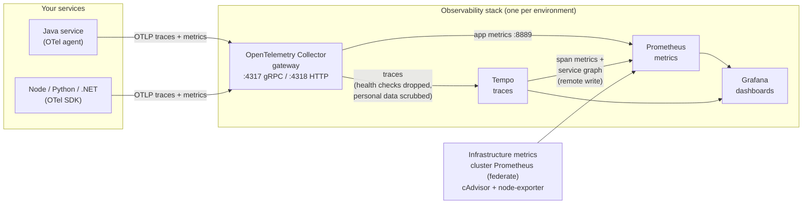
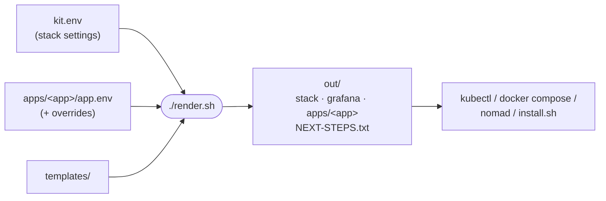

# Observability Kit

<sub><sub>**Distributed tracing, service metrics and ready-made Grafana dashboards for any group of services —
on Kubernetes, Docker Compose, Nomad or plain Linux servers — from one set of templates.**</sub></sub>

<sub><sub>Built on open standards only: [OpenTelemetry](https://opentelemetry.io/) for collection,
[Prometheus](https://prometheus.io/) for metrics, [Grafana Tempo](https://grafana.com/oss/tempo/) for
traces and [Grafana](https://grafana.com/oss/grafana/) for dashboards. No vendor agents, no SaaS, no
Helm required: a small bash script renders plain manifests and config files that you review and apply.</sub></sub>

> <sub><sub>The Kubernetes path runs in production on a microservice platform of 10 Java services
> (~260 req/s, Rancher / RKE2). See [Status and testing](#status-and-testing) for the other platforms.</sub></sub>

## Why this matters

<sub><sub>Logs and CPU graphs tell you **that** something is wrong. They rarely tell you **where** a slow or
failed request spent its time once it crossed five services, a message queue and a database. This
stack records the full path of every request and turns it into numbers you can alert on, so problems
are found by evidence instead of guesswork.</sub></sub>

### Find hidden bugs before users report them

| <sub><sub>Hidden problem</sub></sub> | <sub><sub>How the stack exposes it</sub></sub> |
|---|---|
| <sub><sub>**Errors swallowed between services** — a downstream call fails, the caller retries or returns a default, the user sees "something odd"</sub></sub> | <sub><sub>Error spans and *failed calls between services* show the failing edge even when the entry request returns 200</sub></sub> |
| <sub><sub>**Intermittent failures** that never show up in a test</sub></sub> | <sub><sub>Error rate per service and per span over time; *Error traces* lists every failing request with its full path</sub></sub> |
| <sub><sub>**Timeouts and slow dependencies** (an external API, a cache, another team's service)</sub></sub> | <sub><sub>The service graph and per-span latency show which hop is slow; the trace shows exactly how long each call waited</sub></sub> |
| <sub><sub>**Retry storms and fan-out** — one click causing dozens of calls</sub></sub> | <sub><sub>A single trace shows every call a request triggered, in order, with timings</sub></sub> |
| <sub><sub>**Regressions after a deploy**</sub></sub> | <sub><sub>Latency and error rate per endpoint before / after the rollout, side by side</sub></sub> |
| <sub><sub>**Memory leaks and GC pauses** (Java)</sub></sub> | <sub><sub>Heap used vs. max, GC time and thread count per instance, next to the latency they cause</sub></sub> |
| <sub><sub>**Connection-pool exhaustion**</sub></sub> | <sub><sub>DB connection pool used vs. max per service — requests queue long before the database is busy</sub></sub> |
| <sub><sub>**Pods restarting or starved**</sub></sub> | <sub><sub>Restarts, CPU and memory per pod / container on the same screen as the service's latency</sub></sub> |

### Database monitoring at query level

<sub><sub>The Java agent (and OpenTelemetry SDKs) record **every database call as its own span** — JDBC,
Hibernate / JPA, R2DBC, MongoDB, Redis, Cassandra, Elasticsearch and more — with no code change:</sub></sub>

- <sub><sub>**Which query, how long, from where.** Each DB span carries the database system, database name,
  operation and the **sanitized SQL statement** (literal values replaced by `?`, so no personal data),
  linked to the HTTP request that caused it.</sub></sub>
- <sub><sub>**Slowest queries.** Tempo turns DB spans into metrics: call rate, error rate and p95 latency **per
  query / operation** (*p95 latency per span_name*), so the slowest statements rank themselves.</sub></sub>
- <sub><sub>**N+1 queries.** A trace that shows the same `SELECT` 200 times for one page load is impossible to
  miss — the classic ORM problem that no database dashboard reveals.</sub></sub>
- <sub><sub>**Database as a node in the service map.** Databases and caches appear in the service graph with
  call rate and error rate from every service that uses them.</sub></sub>
- <sub><sub>**Pool vs. query time.** Connection-pool waits (pool metrics) are separated from query execution
  (span duration), so you know whether to tune the pool or the query.</sub></sub>

### Optimize with data

- <sub><sub>**Know where the time goes.** Every slow request breaks down into its spans: application code,
  each downstream service, each query. Optimize the span that dominates, not the one you suspect.</sub></sub>
- <sub><sub>**From graph to cause in one click.** Latency graphs carry **exemplars** — a dot on the p95 line
  opens the actual slow trace behind it.</sub></sub>
- <sub><sub>**Rank endpoints by cost.** Requests/s × p95 per route shows which endpoints are worth optimizing
  first; top-15 routes are on the Service Overview dashboard.</sub></sub>
- <sub><sub>**Right-size resources.** CPU and memory per pod against real traffic show over- and
  under-provisioned services before they cost money or cause OOM kills.</sub></sub>
- <sub><sub>**Prove the improvement.** Compare p95 and error rate of the same endpoint before and after a fix.</sub></sub>
- <sub><sub>**Follow a user action end to end** (optional `user-actions` dashboard): one business action such
  as "submit order" across every service it touches.</sub></sub>

### What it found in testing

<sub><sub>During testing on a production microservice platform, traces exposed **critical performance
issues and hidden bugs that logs, CPU graphs and functional tests had not shown**. Two real traces
(service names, API paths, table and class names blurred). Below, the services are called by role:
the **entry service** that received the request, the **permission service**, a second **domain
service** and a **shared service**.</sub></sub>

#### A slow request: 485 ms and 422 spans to read one record


<sub><sub>What the trace shows:</sub></sub>

- <sub><sub>**Massive fan-out.** A single read of one record produces **422 spans**: HTTP calls to three
  other services (one of them calling back) and hundreds of repository / `SELECT` calls. No single
  query is slow (most are 0.5–5 ms) — the request is slow because of **how many** there are.</sub></sub>
- <sub><sub>**The same work repeated.** The permission check and the user validation in the permission
  service are called **again at every level** of the call chain (7.41 ms, 18.47 ms, then 5.64 ms and
  17.9 ms inside the nested call) — the same answer fetched over and over within one request.</sub></sub>
- <sub><sub>**A circular call.** The entry service calls the domain service, which calls back into the entry
  service (22.18 ms) — a hidden dependency loop between the services.</sub></sub>
- <sub><sub>**One dominant hop.** The nested `POST` to the domain service takes 102.65 ms of the 485 ms; the
  waterfall shows every downstream call running **one after another**, none in parallel.</sub></sub>
- <sub><sub>**Query-level detail.** Every repository method and its SQL appear with their duration
  (a `findById` followed by its `SELECT`), so N+1 patterns are counted, not guessed.</sub></sub>

#### A hidden error: a failing call inside a "successful" request


- <sub><sub>The request returns **HTTP 200**, so access logs and the user see success — but a downstream
  call inside it (the domain service's `GET`, red icon) **failed**. The caller swallowed the error
  and carried on, possibly with incomplete data. Only the trace shows it.</sub></sub>
- <sub><sub>Every repository lookup runs in **its own transaction** (`Transaction.commit` after each
  `findById`), and the same **reference data** (application, permission list, user) is loaded with a
  `Session.find` + `SELECT` on **every** call.</sub></sub>

#### Optimizations these traces point to

| <sub><sub>Finding</sub></sub> | <sub><sub>Optimization</sub></sub> |
|---|---|
| <sub><sub>Permission / user checks repeated at each hop</sub></sub> | <sub><sub>Validate once at the entry service and pass the result (or a short-lived cache per request / token)</sub></sub> |
| <sub><sub>Hundreds of small queries per request</sub></sub> | <sub><sub>Batch lookups (`findAllById`, joins / fetch joins) instead of one query per item</sub></sub> |
| <sub><sub>Reference data loaded on every call</sub></sub> | <sub><sub>Cache rarely-changing data (applications, permission lists, issue types)</sub></sub> |
| <sub><sub>One transaction per read</sub></sub> | <sub><sub>Read-only transactions around the whole operation instead of per repository call</sub></sub> |
| <sub><sub>Sequential downstream calls</sub></sub> | <sub><sub>Run independent calls in parallel</sub></sub> |
| <sub><sub>Circular service calls</sub></sub> | <sub><sub>Return the needed data with the first call, or move the logic to one service</sub></sub> |
| <sub><sub>Errors swallowed inside 200 responses</sub></sub> | <sub><sub>Fail visibly or report partial results; alert on error spans, not only on HTTP 5xx</sub></sub> |

<sub><sub>Each fix can be verified with the same dashboards: span count per request, p95 latency per endpoint
and error spans before and after.</sub></sub>

### For the team

- <sub><sub>**Faster incidents:** start from the alert, open the failing traces, see the failing hop — minutes
  instead of hours of log searching across services.</sub></sub>
- <sub><sub>**One shared picture** for developers, operations and management: the same dashboards per app,
  the same numbers.</sub></sub>
- <sub><sub>**Open standards, no lock-in:** OpenTelemetry instrumentation works with any backend; the stack
  runs on your own infrastructure, so trace data never leaves it.</sub></sub>

<sub><sub>What it does **not** do (yet): it collects no logs (`OTEL_LOGS_EXPORTER=none`), no continuous
profiling, and no database-server internals (query plans, locks, buffer cache) — use the database's
own tools for those. The query-level view above is from the application's side.</sub></sub>

## Contents

- <sub><sub>[Why this matters](#why-this-matters)</sub></sub>
- <sub><sub>[What you get](#what-you-get)</sub></sub>
- <sub><sub>[How it works](#how-it-works)</sub></sub>
- <sub><sub>[Supported platforms](#supported-platforms)</sub></sub>
- <sub><sub>[Requirements](#requirements)</sub></sub>
- <sub><sub>[Quick start](#quick-start)</sub></sub>
- <sub><sub>[Deploying with an AI agent](#deploying-with-an-ai-agent)</sub></sub>
- <sub><sub>[Configuration reference](#configuration-reference)</sub></sub>
- <sub><sub>[Adding an app](#adding-an-app)</sub></sub>
- <sub><sub>[Deployment per platform](#deployment-per-platform)</sub></sub>
- <sub><sub>[Dashboards](#dashboards)</sub></sub>
- <sub><sub>[Alerts](#alerts)</sub></sub>
- <sub><sub>[Day-2 operations](#day-2-operations)</sub></sub>
- <sub><sub>[Sizing](#sizing)</sub></sub>
- <sub><sub>[Security](#security)</sub></sub>
- <sub><sub>[Troubleshooting](#troubleshooting)</sub></sub>
- <sub><sub>[Repository layout](#repository-layout)</sub></sub>
- <sub><sub>[How rendering works](#how-rendering-works)</sub></sub>
- <sub><sub>[Component versions](#component-versions)</sub></sub>
- <sub><sub>[Status and testing](#status-and-testing)</sub></sub>
- <sub><sub>[Contributing](#contributing)</sub></sub>

## What you get

| | |
|---|---|
| <sub><sub>**Traces**</sub></sub> | <sub><sub>Every request followed across services (HTTP, database, messaging, cache calls), searchable by service, duration and error in Grafana</sub></sub> |
| <sub><sub>**Service map**</sub></sub> | <sub><sub>Who calls whom, with call rates and error rates on every edge — generated from traces, no configuration</sub></sub> |
| <sub><sub>**RED metrics**</sub></sub> | <sub><sub>Request rate, error rate and latency (p50 / p95) per service, per endpoint and per span — derived from traces, so they cover every instrumented service</sub></sub> |
| <sub><sub>**Runtime metrics**</sub></sub> | <sub><sub>JVM heap, GC, threads, CPU and DB connection pools (Java)</sub></sub> |
| <sub><sub>**Infrastructure**</sub></sub> | <sub><sub>Pod / container CPU, memory, restarts and node CPU, memory, disk, network next to the traces</sub></sub> |
| <sub><sub>**Click-through**</sub></sub> | <sub><sub>From a latency spike on a graph to the exact slow trace (exemplars), and from a span back to its metrics</sub></sub> |
| <sub><sub>**Alerts**</sub></sub> | <sub><sub>High error rate, high latency, and the monitoring pipeline's own health</sub></sub> |
| <sub><sub>**Zero-code Java**</sub></sub> | <sub><sub>On Kubernetes, the OpenTelemetry Java agent is added to existing deployments **without changing the image**</sub></sub> |
| <sub><sub>**Privacy by default**</sub></sub> | <sub><sub>Health-check spans dropped; query strings and client IPs removed before anything is stored</sub></sub> |

<sub><sub>One **stack** per environment is shared by any number of **apps**. Each app gets its own Grafana
folder and dashboards, filtered to its services.</sub></sub>

## How it works



1. <sub><sub>Services send **OTLP** (traces and metrics) to the **gateway collector**.</sub></sub>
2. <sub><sub>The gateway enriches the data (Kubernetes pod / node metadata), drops health-check noise,
   strips personal data, then sends **traces to Tempo** and exposes **app metrics to Prometheus**.</sub></sub>
3. <sub><sub>**Tempo** stores traces and generates **span metrics** (rate / errors / latency per service and
   span) and the **service graph**, which it writes into Prometheus.</sub></sub>
4. <sub><sub>**Prometheus** also collects **infrastructure metrics** — read-only from the cluster's existing
   Prometheus on Kubernetes, or from cAdvisor / node-exporter elsewhere.</sub></sub>
5. <sub><sub>**Grafana** shows everything through two datasources with fixed uids (`obs-prometheus`,
   `obs-tempo`) that all dashboards use.</sub></sub>



<sub><sub>`render.sh` only writes files. **Nothing changes in a cluster or on a server until you run the
printed commands**, so every change can be reviewed first (`kubectl diff`, `nomad job plan`, `git diff`).</sub></sub>

## Supported platforms

| <sub><sub>`TARGET`</sub></sub> | <sub><sub>Stack runs as</sub></sub> | <sub><sub>Infra metrics (`INFRA_METRICS=auto`)</sub></sub> | <sub><sub>App instrumentation</sub></sub> |
|---|---|---|---|
| <sub><sub>`kubernetes`</sub></sub> | <sub><sub>Deployment + StatefulSets (Kustomize)</sub></sub> | <sub><sub>`federate` from the cluster's Prometheus (Rancher monitoring, kube-prometheus-stack)</sub></sub> | <sub><sub>Strategic-merge patch per Deployment (Java agent via init container, or env only); Helm post-renderer</sub></sub> |
| <sub><sub>`compose`</sub></sub> | <sub><sub>Docker Compose project</sub></sub> | <sub><sub>`cadvisor` + node-exporter in the stack</sub></sub> | <sub><sub>`otel.env` + Compose overlay with an agent init service</sub></sub> |
| <sub><sub>`nomad`</sub></sub> | <sub><sub>One Nomad service job (Docker driver) + optional system job</sub></sub> | <sub><sub>`nomad`: node-exporter + cAdvisor on every client, discovered through Nomad services</sub></sub> | <sub><sub>Task snippet: `artifact` (agent jar) + template (gateway found via Nomad service discovery)</sub></sub> |
| <sub><sub>`host`</sub></sub> | <sub><sub>systemd services, no containers</sub></sub> | <sub><sub>`node`: node-exporter on the host</sub></sub> | <sub><sub>`otel.env` + systemd drop-in</sub></sub> |

| <sub><sub>`GRAFANA_MODE`</sub></sub> | <sub><sub>Use when</sub></sub> |
|---|---|
| <sub><sub>`bundled`</sub></sub> | <sub><sub>You have no Grafana — the kit runs one with datasources and dashboards provisioned</sub></sub> |
| <sub><sub>`sidecar`</sub></sub> | <sub><sub>Kubernetes Grafana with the dashboard sidecar (Rancher monitoring, kube-prometheus-stack) — dashboards become ConfigMaps, datasources go into its Helm values</sub></sub> |
| <sub><sub>`api`</sub></sub> | <sub><sub>Any existing Grafana reachable over HTTP — a generated `import.sh` adds datasources and dashboards with a service-account token</sub></sub> |

## Requirements

<sub><sub>**To render** (your workstation or CI): `bash` 4+, `sed`, `awk`. Linux, WSL, Git Bash on Windows;
on macOS install GNU bash (`brew install bash`).</sub></sub>

<sub><sub>**To deploy:**</sub></sub>

| <sub><sub>Target</sub></sub> | <sub><sub>Needs</sub></sub> |
|---|---|
| <sub><sub>kubernetes</sub></sub> | <sub><sub>`kubectl` 1.27+ (built-in Kustomize), cluster-admin once (ClusterRole for pod metadata), a StorageClass for 2–3 PVCs</sub></sub> |
| <sub><sub>compose</sub></sub> | <sub><sub>Docker Engine 24+ with Compose v2</sub></sub> |
| <sub><sub>nomad</sub></sub> | <sub><sub>Nomad 1.5+ (native service discovery, variables), Docker driver with bind volumes and privileged containers enabled (infra job)</sub></sub> |
| <sub><sub>host</sub></sub> | <sub><sub>Linux with systemd, x86_64 (for `install.sh --download`), root</sub></sub> |

<sub><sub>**Services:** anything that speaks OTLP. Java needs no code change. Other languages need an
OpenTelemetry SDK or auto-instrumentation in the image — see [docs/instrumentation.md](docs/instrumentation.md).</sub></sub>

## Quick start

```bash
git clone <this repository> observability-kit
cd observability-kit

cp kit.env.example kit.env              # 1. stack settings: TARGET, STACK_NAME, ENVIRONMENT, SIZE, GRAFANA_MODE
cp -r apps/example apps/orders          # 2. one folder per app
$EDITOR apps/orders/app.env             #    service-name regex, namespace, deployments, dashboard folder
$EDITOR kit.env                         #    APPS="orders"

./render.sh                             # 3. renders out/ and prints the exact next commands
cat out/NEXT-STEPS.txt
```

<sub><sub>Minimal `kit.env` for an existing Rancher cluster:</sub></sub>

```bash
TARGET=kubernetes
STACK_NAME=observability
ENVIRONMENT=staging
APPS="orders"
SIZE=small
GRAFANA_MODE=sidecar                    # use Rancher's Grafana
STORAGE_CLASS=longhorn
```

<sub><sub>Minimal `apps/orders/app.env`:</sub></sub>

```bash
APP_NAME=orders
SERVICE_REGEX=orders-.*                 # matches the deployment names
DASHBOARD_FOLDER="Orders"
DASHBOARD_UID_PREFIX=orders-
DASHBOARD_TITLE_PREFIX="Orders - "
APP_NAMESPACE=orders
TARGETS="orders-api orders-worker"      # Java deployments to instrument
```

<sub><sub>Several environments from one repository:</sub></sub>

```bash
KIT_ENV=staging.env    OUT=out-staging    ./render.sh
KIT_ENV=production.env OUT=out-production ./render.sh
```

## Deploying with an AI agent

<sub><sub>Two agent-independent prompts in [`prompts/`](prompts/) run the whole process interactively: they
**ask about the environment and the apps**, write the settings, render, and deploy **one step at a
time, asking before every change** and verifying each step.</sub></sub>

| <sub><sub>Prompt</sub></sub> | <sub><sub>Use</sub></sub> |
|---|---|
| <sub><sub>[prompts/deploy-stack.md](prompts/deploy-stack.md)</sub></sub> | <sub><sub>Set up the stack in a new environment</sub></sub> |
| <sub><sub>[prompts/add-app.md](prompts/add-app.md)</sub></sub> | <sub><sub>Onboard one more app into an existing stack</sub></sub> |

- <sub><sub>**Agents that read [`AGENTS.md`](AGENTS.md)** (e.g. OpenAI Codex, Cursor, GitHub Copilot's coding
  agent; others such as Gemini CLI or Aider can be pointed at it in their settings): open the folder
  and say *"deploy the stack to staging"* or *"add the app orders"*.</sub></sub>
- <sub><sub>**Claude Code:** `/deploy-stack staging`, `/add-app orders`.</sub></sub>
- <sub><sub>**Any chat assistant:** paste or attach the prompt file. Without shell access the assistant gives
  you one command at a time and asks for its output.</sub></sub>

<sub><sub>Rules every agent follows (from `AGENTS.md`): confirm the Kubernetes context first, explicit approval
for every changing command, never handle passwords or tokens, stop on a failed check.</sub></sub>

## Configuration reference

<details><summary><b>Show all settings (stack and app)</b></summary>

### Stack settings — `kit.env`

<sub><sub>An empty value means "use the default". Values are substituted as plain text: quote values with
spaces; do not use `#`, `&`, `"` or backslashes.</sub></sub>

<sub><sub>**What and where**</sub></sub>

| <sub><sub>Setting</sub></sub> | <sub><sub>Default</sub></sub> | <sub><sub>Description</sub></sub> |
|---|---|---|
| <sub><sub>`TARGET`</sub></sub> | <sub><sub>`kubernetes`</sub></sub> | <sub><sub>`kubernetes` · `compose` · `nomad` · `host`</sub></sub> |
| <sub><sub>`STACK_NAME`</sub></sub> | <sub><sub>`observability`</sub></sub> | <sub><sub>Kubernetes namespace / Compose project and network / Nomad job / systemd unit prefix. Lower-case letters, digits, `-`</sub></sub> |
| <sub><sub>`ENVIRONMENT`</sub></sub> | <sub><sub>`production`</sub></sub> | <sub><sub>`deployment.environment` on all telemetry and an external label in Prometheus</sub></sub> |
| <sub><sub>`APPS`</sub></sub> | <sub><sub>—</sub></sub> | <sub><sub>Space-separated app folders under `apps/` to render</sub></sub> |

<sub><sub>**Sizing** — see [Sizing](#sizing). `SIZE` sets all of these; any value set here wins.</sub></sub>

| <sub><sub>Setting</sub></sub> | <sub><sub>Description</sub></sub> |
|---|---|
| <sub><sub>`SIZE`</sub></sub> | <sub><sub>`small` · `medium` · `large`</sub></sub> |
| <sub><sub>`PROMETHEUS_RETENTION_TIME`, `PROMETHEUS_RETENTION_SIZE`</sub></sub> | <sub><sub>How long / how much Prometheus keeps (whichever is hit first)</sub></sub> |
| <sub><sub>`PROMETHEUS_VOLUME`, `TEMPO_VOLUME`, `GRAFANA_VOLUME`</sub></sub> | <sub><sub>PVC sizes (Kubernetes), `<n>Mi` / `<n>Gi`</sub></sub> |
| <sub><sub>`PROMETHEUS_MEMORY_REQUEST` / `_LIMIT`, `TEMPO_MEMORY_REQUEST` / `_LIMIT`, `GATEWAY_MEMORY_REQUEST` / `_LIMIT`, `GRAFANA_MEMORY_REQUEST` / `_LIMIT`</sub></sub> | <sub><sub>Memory per component, `<n>Mi` / `<n>Gi` (converted for Compose, Nomad and systemd)</sub></sub> |
| <sub><sub>`TEMPO_RETENTION`</sub></sub> | <sub><sub>How long traces are kept (e.g. `24h`)</sub></sub> |
| <sub><sub>`TRACE_SAMPLE_RATIO`</sub></sub> | <sub><sub>`1.0` keeps every trace; `0.25` keeps a quarter (parent-based, so kept traces stay complete). App metrics are never sampled</sub></sub> |

<sub><sub>**Grafana**</sub></sub>

| <sub><sub>Setting</sub></sub> | <sub><sub>Default</sub></sub> | <sub><sub>Description</sub></sub> |
|---|---|---|
| <sub><sub>`GRAFANA_MODE`</sub></sub> | <sub><sub>`bundled`</sub></sub> | <sub><sub>`bundled` · `sidecar` (Kubernetes) · `api`</sub></sub> |
| <sub><sub>`GRAFANA_PORT`</sub></sub> | <sub><sub>`3000`</sub></sub> | <sub><sub>Published port (compose / nomad / host)</sub></sub> |
| <sub><sub>`GRAFANA_INGRESS_HOST`, `GRAFANA_INGRESS_CLASS`</sub></sub> | <sub><sub>—</sub></sub> | <sub><sub>Kubernetes + bundled: create an Ingress for this host (empty = use port-forward)</sub></sub> |
| <sub><sub>`DASHBOARD_NAMESPACE`</sub></sub> | <sub><sub>`cattle-dashboards`</sub></sub> | <sub><sub>Sidecar: namespace the Grafana sidecar watches (kube-prometheus-stack: its own namespace)</sub></sub> |
| <sub><sub>`PROMETHEUS_URL_FOR_GRAFANA`, `TEMPO_URL_FOR_GRAFANA`</sub></sub> | <sub><sub>derived</sub></sub> | <sub><sub>How Grafana reaches the stack; set them for `api` mode when Grafana runs elsewhere</sub></sub> |

<sub><sub>**Infrastructure metrics**</sub></sub>

| <sub><sub>Setting</sub></sub> | <sub><sub>Default</sub></sub> | <sub><sub>Description</sub></sub> |
|---|---|---|
| <sub><sub>`INFRA_METRICS`</sub></sub> | <sub><sub>`auto`</sub></sub> | <sub><sub>`auto` · `federate` · `cadvisor` · `nomad` · `node` · `none` (see [Supported platforms](#supported-platforms))</sub></sub> |
| <sub><sub>`FEDERATE_FROM`</sub></sub> | <sub><sub>Rancher's Prometheus</sub></sub> | <sub><sub>`host:port` of the cluster Prometheus to federate from (kube-prometheus-stack: `prometheus-operated.monitoring.svc:9090`)</sub></sub> |

<sub><sub>**Platform-specific**</sub></sub>

| <sub><sub>Setting</sub></sub> | <sub><sub>Target</sub></sub> | <sub><sub>Description</sub></sub> |
|---|---|---|
| <sub><sub>`STORAGE_CLASS`</sub></sub> | <sub><sub>kubernetes</sub></sub> | <sub><sub>StorageClass for the PVCs (empty = cluster default)</sub></sub> |
| <sub><sub>`BIND_ADDRESS`</sub></sub> | <sub><sub>compose / nomad / host</sub></sub> | <sub><sub>Address OTLP (4317/4318) and Grafana listen on. `0.0.0.0` = reachable from other hosts</sub></sub> |
| <sub><sub>`ADMIN_BIND_ADDRESS`</sub></sub> | <sub><sub>compose / nomad / host</sub></sub> | <sub><sub>Address of Prometheus (9090) and Tempo (3200). Default `127.0.0.1`</sub></sub> |
| <sub><sub>`HOST_LABEL`</sub></sub> | <sub><sub>compose / nomad / host</sub></sub> | <sub><sub>Name of the stack's machine: `instance` label of its metrics and the OTLP address given to apps (default: hostname of the rendering machine; nomad: `NOMAD_NODE_NAME`)</sub></sub> |
| <sub><sub>`NOMAD_DATACENTERS`, `NOMAD_NAMESPACE`</sub></sub> | <sub><sub>nomad</sub></sub> | <sub><sub>Where the jobs run. Datacenters as a quoted HCL list: `'"dc1", "dc2"'`</sub></sub> |
| <sub><sub>`NOMAD_NODE_NAME`</sub></sub> | <sub><sub>nomad</sub></sub> | <sub><sub>**Required.** Node the stack is pinned to (its host volumes live there)</sub></sub> |
| <sub><sub>`NOMAD_ADDR`</sub></sub> | <sub><sub>nomad</sub></sub> | <sub><sub>Nomad API for Prometheus service discovery (default: the node's own IP)</sub></sub> |
| <sub><sub>`CONFIG_DIR`, `DATA_DIR`</sub></sub> | <sub><sub>host</sub></sub> | <sub><sub>Default `/etc/observability`, `/var/lib/observability`</sub></sub> |

<sub><sub>**Traces**</sub></sub>

| <sub><sub>Setting</sub></sub> | <sub><sub>Description</sub></sub> |
|---|---|
| <sub><sub>`DROP_PATHS_REGEX`</sub></sub> | <sub><sub>Server spans whose path matches are dropped. Default: health, readiness, liveness, ping, metrics and Spring actuator endpoints</sub></sub> |
| <sub><sub>`SPAN_METRICS_DIMENSIONS`</sub></sub> | <sub><sub>Extra **low-cardinality** span attributes as span-metric labels, comma-separated. `user.action` is added automatically when an app uses the `user-actions` dashboard</sub></sub> |

<sub><sub>**Images** — pin versions; point them at a mirror for air-gapped installs:
`IMAGE_OTEL_COLLECTOR`, `IMAGE_PROMETHEUS`, `IMAGE_TEMPO`, `IMAGE_GRAFANA`, `IMAGE_JAVA_AGENT`,
`IMAGE_CADVISOR`, `IMAGE_NODE_EXPORTER`, and `JAVA_AGENT_URL` (jar download for nomad / host).</sub></sub>

### App settings — `apps/<app>/app.env`

| <sub><sub>Setting</sub></sub> | <sub><sub>Description</sub></sub> |
|---|---|
| <sub><sub>`APP_NAME`</sub></sub> | <sub><sub>Name used in labels and file names (default: folder name)</sub></sub> |
| <sub><sub>`ENVIRONMENT`</sub></sub> | <sub><sub>Overrides the stack's `ENVIRONMENT` for this app</sub></sub> |
| <sub><sub>`SERVICE_REGEX`</sub></sub> | <sub><sub>**Required.** Regex matching the `OTEL_SERVICE_NAME` of every service of the app; dashboards show only these. On Kubernetes the kit sets `OTEL_SERVICE_NAME` = deployment name</sub></sub> |
| <sub><sub>`DASHBOARD_FOLDER`</sub></sub> | <sub><sub>Grafana folder for the app's dashboards</sub></sub> |
| <sub><sub>`DASHBOARD_UID_PREFIX`</sub></sub> | <sub><sub>Prefix of dashboard uids — **unique per app** (Grafana uids are global)</sub></sub> |
| <sub><sub>`DASHBOARD_TITLE_PREFIX`</sub></sub> | <sub><sub>Prefix of dashboard titles</sub></sub> |
| <sub><sub>`DASHBOARDS`</sub></sub> | <sub><sub>Which dashboards (see [Dashboards](#dashboards)); empty = the default for the target</sub></sub> |
| <sub><sub>`CONTAINER_REGEX`</sub></sub> | <sub><sub>compose / nomad / host: the app's container names in the Containers & Hosts dashboard</sub></sub> |
| <sub><sub>`APP_NAMESPACE`</sub></sub> | <sub><sub>Kubernetes: the app's namespace</sub></sub> |
| <sub><sub>`TARGETS`</sub></sub> | <sub><sub>Kubernetes: deployments to instrument, `deployment[:container[:mode]]`. `container` defaults to the deployment name; `mode` is `java` (default, adds the agent) or `env` (only `OTEL_*` variables, for images that already contain an OpenTelemetry SDK)</sub></sub> |

<sub><sub>**Overrides** (Kubernetes, optional, applied in the same rollout as the agent):</sub></sub>

| <sub><sub>File</sub></sub> | <sub><sub>Adds</sub></sub> |
|---|---|
| <sub><sub>`apps/<app>/overrides/<deployment>.yaml`</sub></sub> | <sub><sub>Fields of the app container — typically a `startupProbe` (the agent adds 10–60 s of startup) or resources</sub></sub> |
| <sub><sub>`apps/<app>/overrides/<deployment>.init.yaml`</sub></sub> | <sub><sub>Fields of the agent's init container — e.g. a `securityContext` when pods must run as non-root</sub></sub> |

```yaml
# apps/orders/overrides/orders-api.yaml
startupProbe:
  httpGet: { path: /actuator/health, port: 8080 }
  periodSeconds: 10
  failureThreshold: 60
```

<sub><sub>**Extra Prometheus scrape jobs:** put them in `extra-scrape.yml` at the repository root (a YAML list
of `scrape_configs` entries); they are inserted as-is.</sub></sub>

</details>

## Adding an app

1. <sub><sub>`cp -r apps/example apps/<app>` and edit `app.env` ([reference](#app-settings--appsappappenv)).</sub></sub>
2. <sub><sub>Add startup-probe overrides for Java deployments with short liveness probes.</sub></sub>
3. <sub><sub>Add `<app>` to `APPS` and run `./render.sh`. A warning that a deployment does not match
   `SERVICE_REGEX` means it would be missing from the dashboards — fix it.</sub></sub>
4. <sub><sub>Kubernetes: `kubectl apply -k out/stack` again (adds the app's pod metrics to federation), then the
   app's dashboards and instrumentation as below.</sub></sub>

<sub><sub>Or let an AI agent do it: [prompts/add-app.md](prompts/add-app.md).</sub></sub>

## Deployment per platform

<details><summary><b>Show the commands for Kubernetes, Compose, Nomad and Linux hosts</b></summary>

<sub><sub>`./render.sh` prints the exact commands for your settings into `out/NEXT-STEPS.txt`.</sub></sub>

### Kubernetes

```bash
# 1. Stack (once per cluster, and after kit.env changes or new apps)
kubectl diff -k out/stack
kubectl apply -k out/stack
kubectl -n <STACK_NAME> get pods,pvc

# 2. Grafana — one of:
kubectl apply -k out/grafana                                   # bundled
#   sidecar: merge out/grafana/values-grafana.yaml into the Grafana Helm release
#            (Rancher: Apps → Installed Apps → rancher-monitoring → Edit/Upgrade → YAML, same version)
kubectl apply -k out/apps/<app>/dashboards                     #   sidecar: dashboards per app
GRAFANA_URL=https://grafana.example.com GRAFANA_TOKEN=... \
  out/grafana-api/import.sh                                    # api

# 3. Instrumentation per app (each patch is a rolling restart of that deployment)
DRY_RUN=server out/apps/<app>/instrumentation/apply.sh          # validate, changes nothing
out/apps/<app>/instrumentation/apply.sh <one-deployment>        # try one
out/apps/<app>/instrumentation/apply.sh                         # the rest
```

<sub><sub>Bundled Grafana without an Ingress: `kubectl -n <STACK_NAME> port-forward svc/grafana 3000`.</sub></sub>

<sub><sub>**Helm-managed apps:** `helm upgrade` re-renders the Deployments and removes the agent. Use the
generated post-renderer so upgrades keep it:</sub></sub>

```bash
helm upgrade <release> <chart> -n <namespace> --reuse-values \
  --post-renderer out/apps/<app>/instrumentation/helm-post-renderer.sh
```

<sub><sub>Otherwise re-run `apply.sh` after every upgrade.</sub></sub>

### Docker Compose

```bash
scp -r out/stack monitoring-host:/opt/observability
ssh monitoring-host 'cd /opt/observability && docker compose up -d && docker compose ps'
```

<sub><sub>Apps on the same Docker host join the network `<STACK_NAME>` and send to `http://otel-collector:4317`;
apps on other hosts send to `http://<HOST_LABEL>:4317`. Merge
`out/apps/<app>/instrumentation/docker-compose.otel.yml` into the app's compose file — a one-shot
`otel-agent` service copies the Java agent into a volume, the image stays unchanged.</sub></sub>

### Nomad

```bash
# on NOMAD_NODE_NAME: create the host volumes (directories, owners, client config) — see the file
cat out/stack/client-host-volumes.hcl

nomad var put -namespace <ns> nomad/jobs/<STACK_NAME> \
  grafana_admin_password="$(cat secrets/grafana-admin-password)"
cd out/stack
nomad job plan observability.nomad.hcl && nomad job run observability.nomad.hcl
nomad job run infra.nomad.hcl                       # node-exporter + cAdvisor on every client
```

<sub><sub>Run `nomad job run` from `out/stack`: the job reads its config files relative to that folder. App
tasks find the gateway as the Nomad service `<STACK_NAME>-otlp`; copy the blocks from
`out/apps/<app>/instrumentation/otel-task.nomad.hcl` into each task.</sub></sub>

### Linux hosts (systemd)

```bash
scp -r out/stack monitoring-host:/tmp/observability
ssh monitoring-host 'cd /tmp/observability && sudo ./install.sh --download'
```

<sub><sub>Without internet access, install the binaries first (paths and versions are listed at the top of
`install.sh`) and run it without `--download`. Services: `<STACK_NAME>-prometheus`, `-tempo`,
`-otel-collector`, `-grafana`, `-node-exporter`. Apps get `otel.env` and a systemd drop-in from
`out/apps/<app>/instrumentation/`.</sub></sub>

### Grafana login (bundled)

<sub><sub>User `admin`; the password is generated once into `secrets/grafana-admin-password` (never committed).
It only applies when Grafana creates its database — change it in Grafana afterwards.</sub></sub>

</details>

## Dashboards

<sub><sub>All dashboards are filtered to the app's services (`SERVICE_REGEX`) and have service / host
selectors.</sub></sub>

| <sub><sub>Dashboard</sub></sub> | <sub><sub>Default on</sub></sub> | <sub><sub>Shows</sub></sub> |
|---|---|---|
| <sub><sub>**Traces** (`traces`)</sub></sub> | <sub><sub>all</sub></sub> | <sub><sub>Service graph; calls and failed calls between services; request rate, error rate and p95 latency per service and per span; slow traces (>300 ms); error traces and error spans; a trace viewer</sub></sub> |
| <sub><sub>**Service Overview** (`service-overview`)</sub></sub> | <sub><sub>all</sub></sub> | <sub><sub>Services reporting; requests/s, 5xx %, p95 latency (totals, per service, per route); JVM heap, CPU, GC time, threads; DB connection pool usage</sub></sub> |
| <sub><sub>**Service Monitoring (Kubernetes)** (`kubernetes-resources`)</sub></sub> | <sub><sub>kubernetes + federate</sub></sub> | <sub><sub>Services up, ready replicas; pod CPU, memory, restarts; HTTP rate / errors / latency; node CPU, memory, disk, network</sub></sub> |
| <sub><sub>**Containers & Hosts** (`containers-hosts`)</sub></sub> | <sub><sub>compose / nomad / host</sub></sub> | <sub><sub>Container CPU, memory, network, restarts; host CPU, memory, disk per mount, load</sub></sub> |
| <sub><sub>**Actions** (`user-actions`)</sub></sub> | <sub><sub>opt-in</sub></sub> | <sub><sub>Everything that happened for one user action (e.g. `POST /orders`) across all services: calls, errors, latency per service and span, matching traces. Needs a `user.action` baggage entry set by the app — see [docs/instrumentation.md](docs/instrumentation.md#useraction-optional-user-actions-dashboard)</sub></sub> |

<sub><sub>From any latency graph, click an **exemplar** dot to open the trace behind it; from a span in a
trace, jump to its request / error / latency metrics.</sub></sub>

## Alerts

<sub><sub>Evaluated by Prometheus; visible in Prometheus `/alerts` and in Grafana (Alerting → Alert rules).
No Alertmanager is deployed, so **nothing is sent** until you connect one — see
[docs/operations.md](docs/operations.md#alerts).</sub></sub>

| <sub><sub>Alert</sub></sub> | <sub><sub>Fires when</sub></sub> |
|---|---|
| <sub><sub>`HighErrorRate`</sub></sub> | <sub><sub>>5 % of a service's HTTP requests return 5xx for 5 min</sub></sub> |
| <sub><sub>`HighLatencyP95`</sub></sub> | <sub><sub>p95 HTTP latency of a service >1 s for 10 min</sub></sub> |
| <sub><sub>`CollectorDroppingData`</sub></sub> | <sub><sub>the gateway fails to export traces or metrics</sub></sub> |
| <sub><sub>`CollectorRefusingData`</sub></sub> | <sub><sub>the gateway refuses data (memory limit reached)</sub></sub> |
| <sub><sub>`PrometheusRuleEvaluationFailures`</sub></sub> | <sub><sub>an alert rule fails to evaluate</sub></sub> |

## Day-2 operations

| <sub><sub>Task</sub></sub> | <sub><sub>How</sub></sub> |
|---|---|
| <sub><sub>Change a setting</sub></sub> | <sub><sub>Edit `kit.env` / `app.env` → `./render.sh` → apply again (Kubernetes restarts only pods whose config changed)</sub></sub> |
| <sub><sub>Add an app</sub></sub> | <sub><sub>[Adding an app](#adding-an-app)</sub></sub> |
| <sub><sub>Remove the agent from one deployment</sub></sub> | <sub><sub>`kubectl -n <ns> rollout undo deployment/<name>`</sub></sub> |
| <sub><sub>Upgrade components</sub></sub> | <sub><sub>Change `IMAGE_*` → render → apply on a test environment first (read the release notes)</sub></sub> |
| <sub><sub>Watch capacity</sub></sub> | <sub><sub>`prometheus_tsdb_head_series`, Tempo bytes received, stack pod memory and restarts — see [docs/operations.md](docs/operations.md#watching-capacity-first-week-after-adding-an-app)</sub></sub> |
| <sub><sub>Roll back everything</sub></sub> | <sub><sub>[docs/operations.md → Rollback](docs/operations.md#rollback)</sub></sub> |

<sub><sub>Full guide: **[docs/operations.md](docs/operations.md)** (re-applying per target, alerts, capacity,
troubleshooting, ports, rollback, upgrades).</sub></sub>

## Sizing

| <sub><sub>`SIZE`</sub></sub> | <sub><sub>For</sub></sub> | <sub><sub>Prometheus</sub></sub> | <sub><sub>Tempo</sub></sub> | <sub><sub>Gateway</sub></sub> | <sub><sub>Grafana</sub></sub> |
|---|---|---|---|---|---|
| <sub><sub>`small`</sub></sub> | <sub><sub>≤5 services, ~50 req/s</sub></sub> | <sub><sub>1Gi · 7d / 4GB · 6Gi disk</sub></sub> | <sub><sub>1Gi · 48h · 10Gi disk</sub></sub> | <sub><sub>256Mi</sub></sub> | <sub><sub>256Mi</sub></sub> |
| <sub><sub>`medium`</sub></sub> | <sub><sub>≤15 services, ~300 req/s</sub></sub> | <sub><sub>3Gi · 3d / 8GB · 10Gi disk</sub></sub> | <sub><sub>4Gi · 24h · 30Gi disk</sub></sub> | <sub><sub>512Mi</sub></sub> | <sub><sub>512Mi</sub></sub> |
| <sub><sub>`large`</sub></sub> | <sub><sub>more</sub></sub> | <sub><sub>6Gi · 3d / 16GB · 20Gi disk</sub></sub> | <sub><sub>8Gi · 24h · 60Gi disk</sub></sub> | <sub><sub>1Gi</sub></sub> | <sub><sub>1Gi</sub></sub> |

<sub><sub>(memory limit · retention · volume). `medium` is measured: 10 Java services at ~260 req/s produce
~95k Prometheus series and 1–3.5 GB of traces per day; Prometheus with a 1.5Gi limit was OOM-killed,
Tempo peaked at 2Gi.</sub></sub>

<sub><sub>On the apps' side, each Java agent adds **~100 MB memory per instance and 10–60 s of startup time**.</sub></sub>

<sub><sub>High traffic: lower `TRACE_SAMPLE_RATIO` before adding memory — traces and span metrics shrink,
app metrics stay complete.</sub></sub>

## Security

- <sub><sub>**Personal data:** the gateway removes URL query strings (e-mails, tokens, search terms) and
  client IP addresses from spans before storage, and drops health-check spans entirely.</sub></sub>
- <sub><sub>**OTLP has no authentication.** Kubernetes: the gateway is a ClusterIP service (in-cluster only).
  Elsewhere allow 4317/4318 only from the app hosts on the firewall.</sub></sub>
- <sub><sub>**Admin ports** (Prometheus 9090, Tempo 3200) listen on `ADMIN_BIND_ADDRESS` (`127.0.0.1` by
  default) outside Kubernetes. Full port list: [docs/operations.md](docs/operations.md#ports).</sub></sub>
- <sub><sub>**Least privilege on Kubernetes:** the stack's containers run as non-root with all capabilities
  dropped and a RuntimeDefault seccomp profile; the only cluster-wide permission is read access to
  pods, namespaces, nodes and replicasets (gateway metadata).</sub></sub>
- <sub><sub>**Secrets:** the Grafana admin password lives in `secrets/` (git-ignored) and reaches the platform
  as a Kubernetes Secret, a Compose `.env`, a Nomad variable or a root-only file. The kit stores no
  tokens; `import.sh` reads `GRAFANA_TOKEN` from the environment.</sub></sub>
- <sub><sub>**Retention:** traces are kept for `TEMPO_RETENTION` (24 h by default) — keep it short if span names
  or attributes may contain personal data.</sub></sub>

## Troubleshooting

<details><summary><b>Show symptoms and checks</b></summary>

| <sub><sub>Symptom</sub></sub> | <sub><sub>Check</sub></sub> |
|---|---|
| <sub><sub>A service has no data</sub></sub> | <sub><sub>`OTEL_SERVICE_NAME` matches `SERVICE_REGEX`? Export errors in the service's log? Firewall to 4317?</sub></sub> |
| <sub><sub>Traces but empty HTTP panels</sub></sub> | <sub><sub>Metrics export missing (`OTEL_METRICS_EXPORTER=otlp`)</sub></sub> |
| <sub><sub>Empty service graph</sub></sub> | <sub><sub>Trace context not propagated between the services</sub></sub> |
| <sub><sub>Empty Kubernetes / container panels</sub></sub> | <sub><sub>`INFRA_METRICS`; Kubernetes: is `FEDERATE_FROM` reachable and the `federate` target up?</sub></sub> |
| <sub><sub>Dashboards missing (sidecar)</sub></sub> | <sub><sub>ConfigMaps in `DASHBOARD_NAMESPACE` with label `grafana_dashboard=1`; sidecar container logs</sub></sub> |
| <sub><sub>Pod restarts after adding the agent</sub></sub> | <sub><sub>Liveness probe too short → add a `startupProbe` override</sub></sub> |
| <sub><sub>`render.sh` stops with "unreplaced placeholders"</sub></sub> | <sub><sub>A template uses a value the script does not know — usually a typo in a template edit</sub></sub> |

<sub><sub>More: [docs/operations.md](docs/operations.md#troubleshooting) and
[docs/instrumentation.md](docs/instrumentation.md#checking-a-service).</sub></sub>

</details>

## Repository layout

<details><summary><b>Show the folder structure</b></summary>

```
.
├── render.sh                      # the renderer
├── kit.env.example                # stack settings template (copy to kit.env; no secrets, keep it in git)
├── apps/
│   └── example/                   # one folder per app
│       ├── app.env
│       └── overrides/             # optional per-deployment container / init-container fields
├── templates/
│   ├── common/                    # collector, Prometheus (+ alerts), Tempo, Grafana provisioning / API
│   ├── dashboards/                # Grafana dashboards (datasource uids obs-prometheus / obs-tempo)
│   ├── kubernetes/                # core manifests, bundled Grafana / sidecar values, agent patches
│   ├── compose/                   # docker-compose.yml
│   ├── nomad/                     # stack job, infra system job, host volumes
│   ├── host/                      # install.sh, systemd units
│   └── instrumentation/           # otel.env, Compose / Nomad / systemd snippets for apps
├── docs/
│   ├── instrumentation.md         # what services must send; Java and other languages
│   ├── operations.md              # alerts, capacity, troubleshooting, ports, rollback, upgrades
│   └── migration.md               # adopting the kit for a stack that already runs
├── prompts/                       # guided deployment prompts for any AI agent
├── AGENTS.md                      # entry point for AI agents
├── CLAUDE.md, .claude/commands/   # Claude Code wrappers for the prompts
├── out/                           # generated (git-ignored)
└── secrets/                       # generated Grafana password (git-ignored)
```

</details>

## How rendering works

- <sub><sub>Placeholders `@@NAME@@` in templates are replaced with settings (stack settings, then app
  settings, which win).</sub></sub>
- <sub><sub>Blocks between `#@if <tags>` and `#@endif` are kept only when a tag is active. Tags: the target
  (`kubernetes`, `compose`, …), `infra-<mode>`, `grafana-<mode>`, `storage-class`, `ingress`,
  `ingress-class`, `same-host`. `a|b` means either, `!a` means not; blocks nest.</sub></sub>
- <sub><sub>Lines containing `@@MARKER@@` (e.g. per-app federation selectors, dashboard volumes) are replaced
  with generated content, indented like the marker.</sub></sub>
- <sub><sub>`render.sh` validates settings first (allowed values, memory formats, required fields), then fails
  if any placeholder is left in `out/`.</sub></sub>
- <sub><sub>`out/` is cleared on every run; `secrets/` is kept.</sub></sub>

<sub><sub>To change behaviour, edit the templates and re-render. Before committing a template change, render
every target into scratch folders and check the output (see [Contributing](#contributing)).</sub></sub>

## Component versions

| <sub><sub>Component</sub></sub> | <sub><sub>Version</sub></sub> |
|---|---|
| <sub><sub>OpenTelemetry Collector (contrib)</sub></sub> | <sub><sub>0.162.0</sub></sub> |
| <sub><sub>Prometheus</sub></sub> | <sub><sub>3.15.0</sub></sub> |
| <sub><sub>Grafana Tempo</sub></sub> | <sub><sub>3.1.0</sub></sub> |
| <sub><sub>Grafana</sub></sub> | <sub><sub>12.1.1</sub></sub> |
| <sub><sub>OpenTelemetry Java agent</sub></sub> | <sub><sub>2.32.0</sub></sub> |
| <sub><sub>cAdvisor / node-exporter</sub></sub> | <sub><sub>0.52.1 / 1.9.1</sub></sub> |

<sub><sub>Production reference: Kubernetes 1.30 (RKE2), Rancher monitoring 105.2.1, kubectl 1.34.</sub></sub>

## Status and testing

| <sub><sub>Platform</sub></sub> | <sub><sub>Status</sub></sub> |
|---|---|
| <sub><sub>Kubernetes, `sidecar` Grafana</sub></sub> | <sub><sub>**In production**. Kit output verified identical to the production manifests</sub></sub> |
| <sub><sub>Kubernetes, `bundled` / `api` Grafana</sub></sub> | <sub><sub>Rendered and built with `kubectl kustomize`; not yet deployed</sub></sub> |
| <sub><sub>Docker Compose</sub></sub> | <sub><sub>Rendered; passes `docker compose config`; not yet run</sub></sub> |
| <sub><sub>Nomad</sub></sub> | <sub><sub>Rendered; not yet validated with `nomad job validate` or run</sub></sub> |
| <sub><sub>Linux hosts (systemd)</sub></sub> | <sub><sub>Rendered; not yet validated with `systemd-analyze verify` or run</sub></sub> |

<sub><sub>Every target × Grafana mode combination renders without errors and all YAML / JSON output parses.
Treat the first real deployment on an untested platform as a test, and please report what you find.</sub></sub>

## Contributing

1. <sub><sub>Change templates, `render.sh` or docs on a branch.</sub></sub>
2. <sub><sub>Render every target and Grafana mode into a scratch folder and check the output:</sub></sub>

   ```bash
   for t in kubernetes compose nomad host; do for g in bundled sidecar api; do
     [ $g = sidecar ] && [ $t != kubernetes ] && continue
     sed -e "s/^TARGET=.*/TARGET=$t/" -e "s/^GRAFANA_MODE=.*/GRAFANA_MODE=$g/" \
         -e "s/^NOMAD_NODE_NAME=.*/NOMAD_NODE_NAME=n1/" kit.env.example > /tmp/kit-$t-$g.env
     KIT_ENV=/tmp/kit-$t-$g.env OUT=/tmp/out-$t-$g ./render.sh > /dev/null || echo "FAIL $t/$g"
   done; done
   kubectl kustomize /tmp/out-kubernetes-bundled/stack > /dev/null
   docker compose -f /tmp/out-compose-bundled/stack/docker-compose.yml \
     --env-file /tmp/out-compose-bundled/stack/.env config -q
   ```
3. <sub><sub>For changes to the production path (Kubernetes + sidecar), compare `kubectl diff -k out/stack`
   against the live cluster before merging.</sub></sub>
4. <sub><sub>Keep `README.md`, `docs/` and `prompts/` in sync with behaviour changes.</sub></sub>
