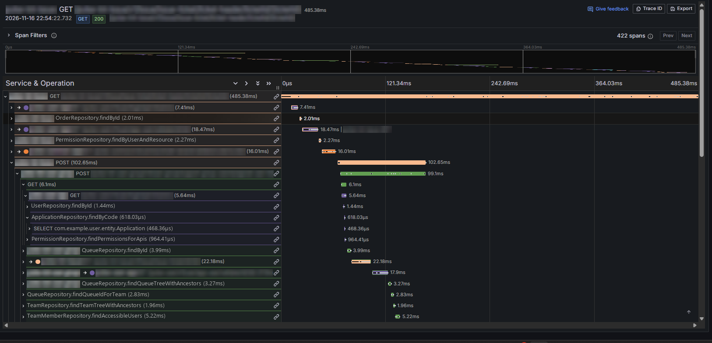
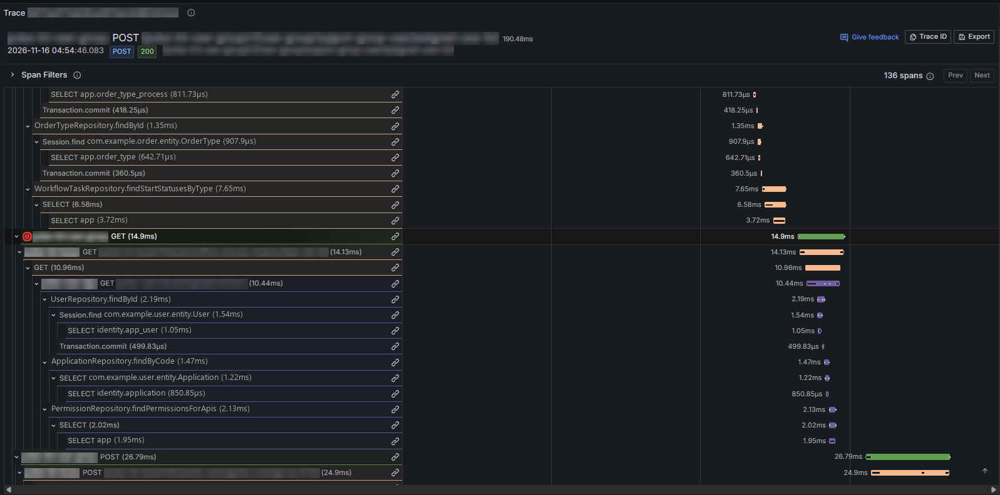
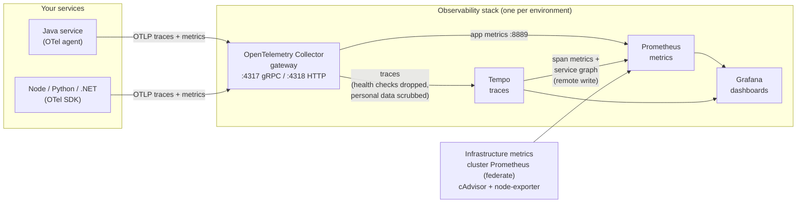

# Observability Kit

**Distributed tracing, service metrics and ready-made Grafana dashboards for any group of services —
on Kubernetes, Docker Compose, Nomad or plain Linux servers — from one set of templates.**

Built on open standards only: [OpenTelemetry](https://opentelemetry.io/) for collection,
[Prometheus](https://prometheus.io/) for metrics, [Grafana Tempo](https://grafana.com/oss/tempo/) for
traces and [Grafana](https://grafana.com/oss/grafana/) for dashboards. No vendor agents, no SaaS, no
Helm required: a small bash script renders plain manifests and config files that you review and apply.

> The Kubernetes path runs in production on a microservice platform of 10 Java services
> (~260 req/s, Rancher / RKE2). See [Status and testing](#status-and-testing) for the other platforms.

---

### Why this matters

Logs and CPU graphs tell you **that** something is wrong. They rarely tell you **where** a slow or
failed request spent its time once it crossed five services, a message queue and a database. This
stack records the full path of every request and turns it into numbers you can alert on, so problems
are found by evidence instead of guesswork.

#### Find hidden bugs before users report them

| Hidden problem | How the stack exposes it |
|---|---|
| **Errors swallowed between services** — a downstream call fails, the caller retries or returns a default, the user sees "something odd" | Error spans and *failed calls between services* show the failing edge even when the entry request returns 200 |
| **Intermittent failures** that never show up in a test | Error rate per service and per span over time; *Error traces* lists every failing request with its full path |
| **Timeouts and slow dependencies** (an external API, a cache, another team's service) | The service graph and per-span latency show which hop is slow; the trace shows exactly how long each call waited |
| **Retry storms and fan-out** — one click causing dozens of calls | A single trace shows every call a request triggered, in order, with timings |
| **Regressions after a deploy** | Latency and error rate per endpoint before / after the rollout, side by side |
| **Memory leaks and GC pauses** (Java) | Heap used vs. max, GC time and thread count per instance, next to the latency they cause |
| **Connection-pool exhaustion** | DB connection pool used vs. max per service — requests queue long before the database is busy |
| **Pods restarting or starved** | Restarts, CPU and memory per pod / container on the same screen as the service's latency |

#### Database monitoring at query level

The Java agent (and OpenTelemetry SDKs) record **every database call as its own span** — JDBC,
Hibernate / JPA, R2DBC, MongoDB, Redis, Cassandra, Elasticsearch and more — with no code change:

- **Which query, how long, from where.** Each DB span carries the database system, database name,
  operation and the **sanitized SQL statement** (literal values replaced by `?`, so no personal data),
  linked to the HTTP request that caused it.
- **Slowest queries.** Tempo turns DB spans into metrics: call rate, error rate and p95 latency **per
  query / operation** (*p95 latency per span_name*), so the slowest statements rank themselves.
- **N+1 queries.** A trace that shows the same `SELECT` 200 times for one page load is impossible to
  miss — the classic ORM problem that no database dashboard reveals.
- **Database as a node in the service map.** Databases and caches appear in the service graph with
  call rate and error rate from every service that uses them.
- **Pool vs. query time.** Connection-pool waits (pool metrics) are separated from query execution
  (span duration), so you know whether to tune the pool or the query.

#### Optimize with data

- **Know where the time goes.** Every slow request breaks down into its spans: application code,
  each downstream service, each query. Optimize the span that dominates, not the one you suspect.
- **From graph to cause in one click.** Latency graphs carry **exemplars** — a dot on the p95 line
  opens the actual slow trace behind it.
- **Rank endpoints by cost.** Requests/s × p95 per route shows which endpoints are worth optimizing
  first; top-15 routes are on the Service Overview dashboard.
- **Right-size resources.** CPU and memory per pod against real traffic show over- and
  under-provisioned services before they cost money or cause OOM kills.
- **Prove the improvement.** Compare p95 and error rate of the same endpoint before and after a fix.
- **Follow a user action end to end** (optional `user-actions` dashboard): one business action such
  as "submit order" across every service it touches.

#### What it found in testing

During testing on a production microservice platform, traces exposed **critical performance
issues and hidden bugs that logs, CPU graphs and functional tests had not shown**. Two real traces
(service names, API paths, table and class names blurred). Below, the services are called by role:
the **entry service** that received the request, the **permission service**, a second **domain
service** and a **shared service**.

##### A slow request: 485 ms and 422 spans to read one record



What the trace shows:

- **Massive fan-out.** A single read of one record produces **422 spans**: HTTP calls to three
  other services (one of them calling back) and hundreds of repository / `SELECT` calls. No single
  query is slow (most are 0.5–5 ms) — the request is slow because of **how many** there are.
- **The same work repeated.** The permission check and the user validation in the permission
  service are called **again at every level** of the call chain (7.41 ms, 18.47 ms, then 5.64 ms and
  17.9 ms inside the nested call) — the same answer fetched over and over within one request.
- **A circular call.** The entry service calls the domain service, which calls back into the entry
  service (22.18 ms) — a hidden dependency loop between the services.
- **One dominant hop.** The nested `POST` to the domain service takes 102.65 ms of the 485 ms; the
  waterfall shows every downstream call running **one after another**, none in parallel.
- **Query-level detail.** Every repository method and its SQL appear with their duration
  (a `findById` followed by its `SELECT`), so N+1 patterns are counted, not guessed.

##### A hidden error: a failing call inside a "successful" request



- The request returns **HTTP 200**, so access logs and the user see success — but a downstream
  call inside it (the domain service's `GET`, red icon) **failed**. The caller swallowed the error
  and carried on, possibly with incomplete data. Only the trace shows it.
- Every repository lookup runs in **its own transaction** (`Transaction.commit` after each
  `findById`), and the same **reference data** (application, permission list, user) is loaded with a
  `Session.find` + `SELECT` on **every** call.

##### Optimizations these traces point to

| Finding | Optimization |
|---|---|
| Permission / user checks repeated at each hop | Validate once at the entry service and pass the result (or a short-lived cache per request / token) |
| Hundreds of small queries per request | Batch lookups (`findAllById`, joins / fetch joins) instead of one query per item |
| Reference data loaded on every call | Cache rarely-changing data (applications, permission lists, issue types) |
| One transaction per read | Read-only transactions around the whole operation instead of per repository call |
| Sequential downstream calls | Run independent calls in parallel |
| Circular service calls | Return the needed data with the first call, or move the logic to one service |
| Errors swallowed inside 200 responses | Fail visibly or report partial results; alert on error spans, not only on HTTP 5xx |

Each fix can be verified with the same dashboards: span count per request, p95 latency per endpoint
and error spans before and after.

#### For the team

- **Faster incidents:** start from the alert, open the failing traces, see the failing hop — minutes
  instead of hours of log searching across services.
- **One shared picture** for developers, operations and management: the same dashboards per app,
  the same numbers.
- **Open standards, no lock-in:** OpenTelemetry instrumentation works with any backend; the stack
  runs on your own infrastructure, so trace data never leaves it.

What it does **not** do (yet): it collects no logs (`OTEL_LOGS_EXPORTER=none`), no continuous
profiling, and no database-server internals (query plans, locks, buffer cache) — use the database's
own tools for those. The query-level view above is from the application's side.

---

### Contents

- [Why this matters](#why-this-matters)
- [What you get](#what-you-get)
- [How it works](#how-it-works)
- [Supported platforms](#supported-platforms)
- [Requirements](#requirements)
- [Quick start](#quick-start)
- [Deploying with an AI agent](#deploying-with-an-ai-agent)
- [Configuration reference](#configuration-reference)
- [Adding an app](#adding-an-app)
- [Deployment per platform](#deployment-per-platform)
- [Dashboards](#dashboards)
- [Alerts](#alerts)
- [Day-2 operations](#day-2-operations)
- [Sizing](#sizing)
- [Security](#security)
- [Troubleshooting](#troubleshooting)
- [Repository layout](#repository-layout)
- [How rendering works](#how-rendering-works)
- [Component versions](#component-versions)
- [Status and testing](#status-and-testing)
- [Contributing](#contributing)

---

### What you get

| | |
|---|---|
| **Traces** | Every request followed across services (HTTP, database, messaging, cache calls), searchable by service, duration and error in Grafana |
| **Service map** | Who calls whom, with call rates and error rates on every edge — generated from traces, no configuration |
| **RED metrics** | Request rate, error rate and latency (p50 / p95) per service, per endpoint and per span — derived from traces, so they cover every instrumented service |
| **Runtime metrics** | JVM heap, GC, threads, CPU and DB connection pools (Java) |
| **Infrastructure** | Pod / container CPU, memory, restarts and node CPU, memory, disk, network next to the traces |
| **Click-through** | From a latency spike on a graph to the exact slow trace (exemplars), and from a span back to its metrics |
| **Alerts** | High error rate, high latency, and the monitoring pipeline's own health |
| **Zero-code Java** | On Kubernetes, the OpenTelemetry Java agent is added to existing deployments **without changing the image** |
| **Privacy by default** | Health-check spans dropped; query strings and client IPs removed before anything is stored |

One **stack** per environment is shared by any number of **apps**. Each app gets its own Grafana
folder and dashboards, filtered to its services.

---

### How it works



1. Services send **OTLP** (traces and metrics) to the **gateway collector**.
2. The gateway enriches the data (Kubernetes pod / node metadata), drops health-check noise,
   strips personal data, then sends **traces to Tempo** and exposes **app metrics to Prometheus**.
3. **Tempo** stores traces and generates **span metrics** (rate / errors / latency per service and
   span) and the **service graph**, which it writes into Prometheus.
4. **Prometheus** also collects **infrastructure metrics** — read-only from the cluster's existing
   Prometheus on Kubernetes, or from cAdvisor / node-exporter elsewhere.
5. **Grafana** shows everything through two datasources with fixed uids (`obs-prometheus`,
   `obs-tempo`) that all dashboards use.


`render.sh` only writes files. **Nothing changes in a cluster or on a server until you run the
printed commands**, so every change can be reviewed first (`kubectl diff`, `nomad job plan`, `git diff`).

---

### Supported platforms

| `TARGET` | Stack runs as | Infra metrics (`INFRA_METRICS=auto`) | App instrumentation |
|---|---|---|---|
| `kubernetes` | Deployment + StatefulSets (Kustomize) | `federate` from the cluster's Prometheus (Rancher monitoring, kube-prometheus-stack) | Strategic-merge patch per Deployment (Java agent via init container, or env only); Helm post-renderer |
| `compose` | Docker Compose project | `cadvisor` + node-exporter in the stack | `otel.env` + Compose overlay with an agent init service |
| `nomad` | One Nomad service job (Docker driver) + optional system job | `nomad`: node-exporter + cAdvisor on every client, discovered through Nomad services | Task snippet: `artifact` (agent jar) + template (gateway found via Nomad service discovery) |
| `host` | systemd services, no containers | `node`: node-exporter on the host | `otel.env` + systemd drop-in |

| `GRAFANA_MODE` | Use when |
|---|---|
| `bundled` | You have no Grafana — the kit runs one with datasources and dashboards provisioned |
| `sidecar` | Kubernetes Grafana with the dashboard sidecar (Rancher monitoring, kube-prometheus-stack) — dashboards become ConfigMaps, datasources go into its Helm values |
| `api` | Any existing Grafana reachable over HTTP — a generated `import.sh` adds datasources and dashboards with a service-account token |

---

### Requirements

**To render** (your workstation or CI): `bash` 4+, `sed`, `awk`. Linux, WSL, Git Bash on Windows;
on macOS install GNU bash (`brew install bash`).

**To deploy:**

| Target | Needs |
|---|---|
| kubernetes | `kubectl` 1.27+ (built-in Kustomize), cluster-admin once (ClusterRole for pod metadata), a StorageClass for 2–3 PVCs |
| compose | Docker Engine 24+ with Compose v2 |
| nomad | Nomad 1.5+ (native service discovery, variables), Docker driver with bind volumes and privileged containers enabled (infra job) |
| host | Linux with systemd, x86_64 (for `install.sh --download`), root |

**Services:** anything that speaks OTLP. Java needs no code change. Other languages need an
OpenTelemetry SDK or auto-instrumentation in the image — see [docs/instrumentation.md](docs/instrumentation.md).

---

### Quick start

```bash
git clone <this repository> observability-kit
cd observability-kit

cp kit.env.example kit.env              # 1. stack settings: TARGET, STACK_NAME, ENVIRONMENT, SIZE, GRAFANA_MODE
cp -r apps/example apps/orders          # 2. one folder per app
$EDITOR apps/orders/app.env             #    service-name regex, namespace, deployments, dashboard folder
$EDITOR kit.env                         #    APPS="orders"

./render.sh                             # 3. renders out/ and prints the exact next commands
cat out/NEXT-STEPS.txt
```

Minimal `kit.env` for an existing Rancher cluster:

```bash
TARGET=kubernetes
STACK_NAME=observability
ENVIRONMENT=staging
APPS="orders"
SIZE=small
GRAFANA_MODE=sidecar                    # use Rancher's Grafana
STORAGE_CLASS=longhorn
```

Minimal `apps/orders/app.env`:

```bash
APP_NAME=orders
SERVICE_REGEX=orders-.*                 # matches the deployment names
DASHBOARD_FOLDER="Orders"
DASHBOARD_UID_PREFIX=orders-
DASHBOARD_TITLE_PREFIX="Orders - "
APP_NAMESPACE=orders
TARGETS="orders-api orders-worker"      # Java deployments to instrument
```

Several environments from one repository:

```bash
KIT_ENV=staging.env    OUT=out-staging    ./render.sh
KIT_ENV=production.env OUT=out-production ./render.sh
```

---

### Deploying with an AI agent

Two agent-independent prompts in [`prompts/`](prompts/) run the whole process interactively: they
**ask about the environment and the apps**, write the settings, render, and deploy **one step at a
time, asking before every change** and verifying each step.

| Prompt | Use |
|---|---|
| [prompts/deploy-stack.md](prompts/deploy-stack.md) | Set up the stack in a new environment |
| [prompts/add-app.md](prompts/add-app.md) | Onboard one more app into an existing stack |

- **Agents that read [`AGENTS.md`](AGENTS.md)** (e.g. OpenAI Codex, Cursor, GitHub Copilot's coding
  agent; others such as Gemini CLI or Aider can be pointed at it in their settings): open the folder
  and say *"deploy the stack to staging"* or *"add the app orders"*.
- **Claude Code:** `/deploy-stack staging`, `/add-app orders`.
- **Any chat assistant:** paste or attach the prompt file. Without shell access the assistant gives
  you one command at a time and asks for its output.

Rules every agent follows (from `AGENTS.md`): confirm the Kubernetes context first, explicit approval
for every changing command, never handle passwords or tokens, stop on a failed check.

---

### Configuration reference

#### Stack settings — `kit.env`

An empty value means "use the default". Values are substituted as plain text: quote values with
spaces; do not use `#`, `&`, `"` or backslashes.

**What and where**

| Setting | Default | Description |
|---|---|---|
| `TARGET` | `kubernetes` | `kubernetes` · `compose` · `nomad` · `host` |
| `STACK_NAME` | `observability` | Kubernetes namespace / Compose project and network / Nomad job / systemd unit prefix. Lower-case letters, digits, `-` |
| `ENVIRONMENT` | `production` | `deployment.environment` on all telemetry and an external label in Prometheus |
| `APPS` | — | Space-separated app folders under `apps/` to render |

**Sizing** — see [Sizing](#sizing). `SIZE` sets all of these; any value set here wins.

| Setting | Description |
|---|---|
| `SIZE` | `small` · `medium` · `large` |
| `PROMETHEUS_RETENTION_TIME`, `PROMETHEUS_RETENTION_SIZE` | How long / how much Prometheus keeps (whichever is hit first) |
| `PROMETHEUS_VOLUME`, `TEMPO_VOLUME`, `GRAFANA_VOLUME` | PVC sizes (Kubernetes), `<n>Mi` / `<n>Gi` |
| `PROMETHEUS_MEMORY_REQUEST` / `_LIMIT`, `TEMPO_MEMORY_REQUEST` / `_LIMIT`, `GATEWAY_MEMORY_REQUEST` / `_LIMIT`, `GRAFANA_MEMORY_REQUEST` / `_LIMIT` | Memory per component, `<n>Mi` / `<n>Gi` (converted for Compose, Nomad and systemd) |
| `TEMPO_RETENTION` | How long traces are kept (e.g. `24h`) |
| `TRACE_SAMPLE_RATIO` | `1.0` keeps every trace; `0.25` keeps a quarter (parent-based, so kept traces stay complete). App metrics are never sampled |

**Grafana**

| Setting | Default | Description |
|---|---|---|
| `GRAFANA_MODE` | `bundled` | `bundled` · `sidecar` (Kubernetes) · `api` |
| `GRAFANA_PORT` | `3000` | Published port (compose / nomad / host) |
| `GRAFANA_INGRESS_HOST`, `GRAFANA_INGRESS_CLASS` | — | Kubernetes + bundled: create an Ingress for this host (empty = use port-forward) |
| `DASHBOARD_NAMESPACE` | `cattle-dashboards` | Sidecar: namespace the Grafana sidecar watches (kube-prometheus-stack: its own namespace) |
| `PROMETHEUS_URL_FOR_GRAFANA`, `TEMPO_URL_FOR_GRAFANA` | derived | How Grafana reaches the stack; set them for `api` mode when Grafana runs elsewhere |

**Infrastructure metrics**

| Setting | Default | Description |
|---|---|---|
| `INFRA_METRICS` | `auto` | `auto` · `federate` · `cadvisor` · `nomad` · `node` · `none` (see [Supported platforms](#supported-platforms)) |
| `FEDERATE_FROM` | Rancher's Prometheus | `host:port` of the cluster Prometheus to federate from (kube-prometheus-stack: `prometheus-operated.monitoring.svc:9090`) |

**Platform-specific**

| Setting | Target | Description |
|---|---|---|
| `STORAGE_CLASS` | kubernetes | StorageClass for the PVCs (empty = cluster default) |
| `BIND_ADDRESS` | compose / nomad / host | Address OTLP (4317/4318) and Grafana listen on. `0.0.0.0` = reachable from other hosts |
| `ADMIN_BIND_ADDRESS` | compose / nomad / host | Address of Prometheus (9090) and Tempo (3200). Default `127.0.0.1` |
| `HOST_LABEL` | compose / nomad / host | Name of the stack's machine: `instance` label of its metrics and the OTLP address given to apps (default: hostname of the rendering machine; nomad: `NOMAD_NODE_NAME`) |
| `NOMAD_DATACENTERS`, `NOMAD_NAMESPACE` | nomad | Where the jobs run. Datacenters as a quoted HCL list: `'"dc1", "dc2"'` |
| `NOMAD_NODE_NAME` | nomad | **Required.** Node the stack is pinned to (its host volumes live there) |
| `NOMAD_ADDR` | nomad | Nomad API for Prometheus service discovery (default: the node's own IP) |
| `CONFIG_DIR`, `DATA_DIR` | host | Default `/etc/observability`, `/var/lib/observability` |

**Traces**

| Setting | Description |
|---|---|
| `DROP_PATHS_REGEX` | Server spans whose path matches are dropped. Default: health, readiness, liveness, ping, metrics and Spring actuator endpoints |
| `SPAN_METRICS_DIMENSIONS` | Extra **low-cardinality** span attributes as span-metric labels, comma-separated. `user.action` is added automatically when an app uses the `user-actions` dashboard |

**Images** — pin versions; point them at a mirror for air-gapped installs:
`IMAGE_OTEL_COLLECTOR`, `IMAGE_PROMETHEUS`, `IMAGE_TEMPO`, `IMAGE_GRAFANA`, `IMAGE_JAVA_AGENT`,
`IMAGE_CADVISOR`, `IMAGE_NODE_EXPORTER`, and `JAVA_AGENT_URL` (jar download for nomad / host).

#### App settings — `apps/<app>/app.env`

| Setting | Description |
|---|---|
| `APP_NAME` | Name used in labels and file names (default: folder name) |
| `ENVIRONMENT` | Overrides the stack's `ENVIRONMENT` for this app |
| `SERVICE_REGEX` | **Required.** Regex matching the `OTEL_SERVICE_NAME` of every service of the app; dashboards show only these. On Kubernetes the kit sets `OTEL_SERVICE_NAME` = deployment name |
| `DASHBOARD_FOLDER` | Grafana folder for the app's dashboards |
| `DASHBOARD_UID_PREFIX` | Prefix of dashboard uids — **unique per app** (Grafana uids are global) |
| `DASHBOARD_TITLE_PREFIX` | Prefix of dashboard titles |
| `DASHBOARDS` | Which dashboards (see [Dashboards](#dashboards)); empty = the default for the target |
| `CONTAINER_REGEX` | compose / nomad / host: the app's container names in the Containers & Hosts dashboard |
| `APP_NAMESPACE` | Kubernetes: the app's namespace |
| `TARGETS` | Kubernetes: deployments to instrument, `deployment[:container[:mode]]`. `container` defaults to the deployment name; `mode` is `java` (default, adds the agent) or `env` (only `OTEL_*` variables, for images that already contain an OpenTelemetry SDK) |

**Overrides** (Kubernetes, optional, applied in the same rollout as the agent):

| File | Adds |
|---|---|
| `apps/<app>/overrides/<deployment>.yaml` | Fields of the app container — typically a `startupProbe` (the agent adds 10–60 s of startup) or resources |
| `apps/<app>/overrides/<deployment>.init.yaml` | Fields of the agent's init container — e.g. a `securityContext` when pods must run as non-root |

```yaml
# apps/orders/overrides/orders-api.yaml
startupProbe:
  httpGet: { path: /actuator/health, port: 8080 }
  periodSeconds: 10
  failureThreshold: 60
```

**Extra Prometheus scrape jobs:** put them in `extra-scrape.yml` at the repository root (a YAML list
of `scrape_configs` entries); they are inserted as-is.

---

### Adding an app

1. `cp -r apps/example apps/<app>` and edit `app.env` ([reference](#app-settings--appsappappenv)).
2. Add startup-probe overrides for Java deployments with short liveness probes.
3. Add `<app>` to `APPS` and run `./render.sh`. A warning that a deployment does not match
   `SERVICE_REGEX` means it would be missing from the dashboards — fix it.
4. Kubernetes: `kubectl apply -k out/stack` again (adds the app's pod metrics to federation), then the
   app's dashboards and instrumentation as below.

Or let an AI agent do it: [prompts/add-app.md](prompts/add-app.md).

---

### Deployment per platform

`./render.sh` prints the exact commands for your settings into `out/NEXT-STEPS.txt`.

#### Kubernetes

```bash
# 1. Stack (once per cluster, and after kit.env changes or new apps)
kubectl diff -k out/stack
kubectl apply -k out/stack
kubectl -n <STACK_NAME> get pods,pvc

# 2. Grafana — one of:
kubectl apply -k out/grafana                                   # bundled
#   sidecar: merge out/grafana/values-grafana.yaml into the Grafana Helm release
#            (Rancher: Apps → Installed Apps → rancher-monitoring → Edit/Upgrade → YAML, same version)
kubectl apply -k out/apps/<app>/dashboards                     #   sidecar: dashboards per app
GRAFANA_URL=https://grafana.example.com GRAFANA_TOKEN=... \
  out/grafana-api/import.sh                                    # api

# 3. Instrumentation per app (each patch is a rolling restart of that deployment)
DRY_RUN=server out/apps/<app>/instrumentation/apply.sh          # validate, changes nothing
out/apps/<app>/instrumentation/apply.sh <one-deployment>        # try one
out/apps/<app>/instrumentation/apply.sh                         # the rest
```

Bundled Grafana without an Ingress: `kubectl -n <STACK_NAME> port-forward svc/grafana 3000`.

**Helm-managed apps:** `helm upgrade` re-renders the Deployments and removes the agent. Use the
generated post-renderer so upgrades keep it:

```bash
helm upgrade <release> <chart> -n <namespace> --reuse-values \
  --post-renderer out/apps/<app>/instrumentation/helm-post-renderer.sh
```

Otherwise re-run `apply.sh` after every upgrade.

#### Docker Compose

```bash
scp -r out/stack monitoring-host:/opt/observability
ssh monitoring-host 'cd /opt/observability && docker compose up -d && docker compose ps'
```

Apps on the same Docker host join the network `<STACK_NAME>` and send to `http://otel-collector:4317`;
apps on other hosts send to `http://<HOST_LABEL>:4317`. Merge
`out/apps/<app>/instrumentation/docker-compose.otel.yml` into the app's compose file — a one-shot
`otel-agent` service copies the Java agent into a volume, the image stays unchanged.

#### Nomad

```bash
# on NOMAD_NODE_NAME: create the host volumes (directories, owners, client config) — see the file
cat out/stack/client-host-volumes.hcl

nomad var put -namespace <ns> nomad/jobs/<STACK_NAME> \
  grafana_admin_password="$(cat secrets/grafana-admin-password)"
cd out/stack
nomad job plan observability.nomad.hcl && nomad job run observability.nomad.hcl
nomad job run infra.nomad.hcl                       # node-exporter + cAdvisor on every client
```

Run `nomad job run` from `out/stack`: the job reads its config files relative to that folder. App
tasks find the gateway as the Nomad service `<STACK_NAME>-otlp`; copy the blocks from
`out/apps/<app>/instrumentation/otel-task.nomad.hcl` into each task.

#### Linux hosts (systemd)

```bash
scp -r out/stack monitoring-host:/tmp/observability
ssh monitoring-host 'cd /tmp/observability && sudo ./install.sh --download'
```

Without internet access, install the binaries first (paths and versions are listed at the top of
`install.sh`) and run it without `--download`. Services: `<STACK_NAME>-prometheus`, `-tempo`,
`-otel-collector`, `-grafana`, `-node-exporter`. Apps get `otel.env` and a systemd drop-in from
`out/apps/<app>/instrumentation/`.

#### Grafana login (bundled)

User `admin`; the password is generated once into `secrets/grafana-admin-password` (never committed).
It only applies when Grafana creates its database — change it in Grafana afterwards.

---

### Dashboards

All dashboards are filtered to the app's services (`SERVICE_REGEX`) and have service / host
selectors.

| Dashboard | Default on | Shows |
|---|---|---|
| **Traces** (`traces`) | all | Service graph; calls and failed calls between services; request rate, error rate and p95 latency per service and per span; slow traces (>300 ms); error traces and error spans; a trace viewer |
| **Service Overview** (`service-overview`) | all | Services reporting; requests/s, 5xx %, p95 latency (totals, per service, per route); JVM heap, CPU, GC time, threads; DB connection pool usage |
| **Service Monitoring (Kubernetes)** (`kubernetes-resources`) | kubernetes + federate | Services up, ready replicas; pod CPU, memory, restarts; HTTP rate / errors / latency; node CPU, memory, disk, network |
| **Containers & Hosts** (`containers-hosts`) | compose / nomad / host | Container CPU, memory, network, restarts; host CPU, memory, disk per mount, load |
| **Actions** (`user-actions`) | opt-in | Everything that happened for one user action (e.g. `POST /orders`) across all services: calls, errors, latency per service and span, matching traces. Needs a `user.action` baggage entry set by the app — see [docs/instrumentation.md](docs/instrumentation.md#useraction-optional-user-actions-dashboard) |

From any latency graph, click an **exemplar** dot to open the trace behind it; from a span in a
trace, jump to its request / error / latency metrics.

---

### Alerts

Evaluated by Prometheus; visible in Prometheus `/alerts` and in Grafana (Alerting → Alert rules).
No Alertmanager is deployed, so **nothing is sent** until you connect one — see
[docs/operations.md](docs/operations.md#alerts).

| Alert | Fires when |
|---|---|
| `HighErrorRate` | >5 % of a service's HTTP requests return 5xx for 5 min |
| `HighLatencyP95` | p95 HTTP latency of a service >1 s for 10 min |
| `CollectorDroppingData` | the gateway fails to export traces or metrics |
| `CollectorRefusingData` | the gateway refuses data (memory limit reached) |
| `PrometheusRuleEvaluationFailures` | an alert rule fails to evaluate |

---

### Day-2 operations

| Task | How |
|---|---|
| Change a setting | Edit `kit.env` / `app.env` → `./render.sh` → apply again (Kubernetes restarts only pods whose config changed) |
| Add an app | [Adding an app](#adding-an-app) |
| Remove the agent from one deployment | `kubectl -n <ns> rollout undo deployment/<name>` |
| Upgrade components | Change `IMAGE_*` → render → apply on a test environment first (read the release notes) |
| Watch capacity | `prometheus_tsdb_head_series`, Tempo bytes received, stack pod memory and restarts — see [docs/operations.md](docs/operations.md#watching-capacity-first-week-after-adding-an-app) |
| Roll back everything | [docs/operations.md → Rollback](docs/operations.md#rollback) |

Full guide: **[docs/operations.md](docs/operations.md)** (re-applying per target, alerts, capacity,
troubleshooting, ports, rollback, upgrades).

---

### Sizing

| `SIZE` | For | Prometheus | Tempo | Gateway | Grafana |
|---|---|---|---|---|---|
| `small` | ≤5 services, ~50 req/s | 1Gi · 7d / 4GB · 6Gi disk | 1Gi · 48h · 10Gi disk | 256Mi | 256Mi |
| `medium` | ≤15 services, ~300 req/s | 3Gi · 3d / 8GB · 10Gi disk | 4Gi · 24h · 30Gi disk | 512Mi | 512Mi |
| `large` | more | 6Gi · 3d / 16GB · 20Gi disk | 8Gi · 24h · 60Gi disk | 1Gi | 1Gi |

(memory limit · retention · volume). `medium` is measured: 10 Java services at ~260 req/s produce
~95k Prometheus series and 1–3.5 GB of traces per day; Prometheus with a 1.5Gi limit was OOM-killed,
Tempo peaked at 2Gi.

On the apps' side, each Java agent adds **~100 MB memory per instance and 10–60 s of startup time**.

High traffic: lower `TRACE_SAMPLE_RATIO` before adding memory — traces and span metrics shrink,
app metrics stay complete.

---

### Security

- **Personal data:** the gateway removes URL query strings (e-mails, tokens, search terms) and
  client IP addresses from spans before storage, and drops health-check spans entirely.
- **OTLP has no authentication.** Kubernetes: the gateway is a ClusterIP service (in-cluster only).
  Elsewhere allow 4317/4318 only from the app hosts on the firewall.
- **Admin ports** (Prometheus 9090, Tempo 3200) listen on `ADMIN_BIND_ADDRESS` (`127.0.0.1` by
  default) outside Kubernetes. Full port list: [docs/operations.md](docs/operations.md#ports).
- **Least privilege on Kubernetes:** the stack's containers run as non-root with all capabilities
  dropped and a RuntimeDefault seccomp profile; the only cluster-wide permission is read access to
  pods, namespaces, nodes and replicasets (gateway metadata).
- **Secrets:** the Grafana admin password lives in `secrets/` (git-ignored) and reaches the platform
  as a Kubernetes Secret, a Compose `.env`, a Nomad variable or a root-only file. The kit stores no
  tokens; `import.sh` reads `GRAFANA_TOKEN` from the environment.
- **Retention:** traces are kept for `TEMPO_RETENTION` (24 h by default) — keep it short if span names
  or attributes may contain personal data.

---

### Troubleshooting

| Symptom | Check |
|---|---|
| A service has no data | `OTEL_SERVICE_NAME` matches `SERVICE_REGEX`? Export errors in the service's log? Firewall to 4317? |
| Traces but empty HTTP panels | Metrics export missing (`OTEL_METRICS_EXPORTER=otlp`) |
| Empty service graph | Trace context not propagated between the services |
| Empty Kubernetes / container panels | `INFRA_METRICS`; Kubernetes: is `FEDERATE_FROM` reachable and the `federate` target up? |
| Dashboards missing (sidecar) | ConfigMaps in `DASHBOARD_NAMESPACE` with label `grafana_dashboard=1`; sidecar container logs |
| Pod restarts after adding the agent | Liveness probe too short → add a `startupProbe` override |
| `render.sh` stops with "unreplaced placeholders" | A template uses a value the script does not know — usually a typo in a template edit |

More: [docs/operations.md](docs/operations.md#troubleshooting) and
[docs/instrumentation.md](docs/instrumentation.md#checking-a-service).

---

### Repository layout

```
.
├── render.sh                      # the renderer
├── kit.env.example                # stack settings template (copy to kit.env; no secrets, keep it in git)
├── apps/
│   └── example/                   # one folder per app
│       ├── app.env
│       └── overrides/             # optional per-deployment container / init-container fields
├── templates/
│   ├── common/                    # collector, Prometheus (+ alerts), Tempo, Grafana provisioning / API
│   ├── dashboards/                # Grafana dashboards (datasource uids obs-prometheus / obs-tempo)
│   ├── kubernetes/                # core manifests, bundled Grafana / sidecar values, agent patches
│   ├── compose/                   # docker-compose.yml
│   ├── nomad/                     # stack job, infra system job, host volumes
│   ├── host/                      # install.sh, systemd units
│   └── instrumentation/           # otel.env, Compose / Nomad / systemd snippets for apps
├── docs/
│   ├── instrumentation.md         # what services must send; Java and other languages
│   ├── operations.md              # alerts, capacity, troubleshooting, ports, rollback, upgrades
│   └── migration.md               # adopting the kit for a stack that already runs
├── prompts/                       # guided deployment prompts for any AI agent
├── AGENTS.md                      # entry point for AI agents
├── CLAUDE.md, .claude/commands/   # Claude Code wrappers for the prompts
├── out/                           # generated (git-ignored)
└── secrets/                       # generated Grafana password (git-ignored)
```

---

### How rendering works

- Placeholders `@@NAME@@` in templates are replaced with settings (stack settings, then app
  settings, which win).
- Blocks between `#@if <tags>` and `#@endif` are kept only when a tag is active. Tags: the target
  (`kubernetes`, `compose`, …), `infra-<mode>`, `grafana-<mode>`, `storage-class`, `ingress`,
  `ingress-class`, `same-host`. `a|b` means either, `!a` means not; blocks nest.
- Lines containing `@@MARKER@@` (e.g. per-app federation selectors, dashboard volumes) are replaced
  with generated content, indented like the marker.
- `render.sh` validates settings first (allowed values, memory formats, required fields), then fails
  if any placeholder is left in `out/`.
- `out/` is cleared on every run; `secrets/` is kept.

To change behaviour, edit the templates and re-render. Before committing a template change, render
every target into scratch folders and check the output (see [Contributing](#contributing)).

---

### Component versions

| Component | Version |
|---|---|
| OpenTelemetry Collector (contrib) | 0.162.0 |
| Prometheus | 3.15.0 |
| Grafana Tempo | 3.1.0 |
| Grafana | 12.1.1 |
| OpenTelemetry Java agent | 2.32.0 |
| cAdvisor / node-exporter | 0.52.1 / 1.9.1 |

Production reference: Kubernetes 1.30 (RKE2), Rancher monitoring 105.2.1, kubectl 1.34.

---

### Status and testing

| Platform | Status |
|---|---|
| Kubernetes, `sidecar` Grafana | **In production**. Kit output verified identical to the production manifests |
| Kubernetes, `bundled` / `api` Grafana | Rendered and built with `kubectl kustomize`; not yet deployed |
| Docker Compose | Rendered; passes `docker compose config`; not yet run |
| Nomad | Rendered; not yet validated with `nomad job validate` or run |
| Linux hosts (systemd) | Rendered; not yet validated with `systemd-analyze verify` or run |

Every target × Grafana mode combination renders without errors and all YAML / JSON output parses.
Treat the first real deployment on an untested platform as a test, and please report what you find.

---

### Contributing

1. Change templates, `render.sh` or docs on a branch.
2. Render every target and Grafana mode into a scratch folder and check the output:

   ```bash
   for t in kubernetes compose nomad host; do for g in bundled sidecar api; do
     [ $g = sidecar ] && [ $t != kubernetes ] && continue
     sed -e "s/^TARGET=.*/TARGET=$t/" -e "s/^GRAFANA_MODE=.*/GRAFANA_MODE=$g/" \
         -e "s/^NOMAD_NODE_NAME=.*/NOMAD_NODE_NAME=n1/" kit.env.example > /tmp/kit-$t-$g.env
     KIT_ENV=/tmp/kit-$t-$g.env OUT=/tmp/out-$t-$g ./render.sh > /dev/null || echo "FAIL $t/$g"
   done; done
   kubectl kustomize /tmp/out-kubernetes-bundled/stack > /dev/null
   docker compose -f /tmp/out-compose-bundled/stack/docker-compose.yml \
     --env-file /tmp/out-compose-bundled/stack/.env config -q
   ```
3. For changes to the production path (Kubernetes + sidecar), compare `kubectl diff -k out/stack`
   against the live cluster before merging.
4. Keep `README.md`, `docs/` and `prompts/` in sync with behaviour changes.
